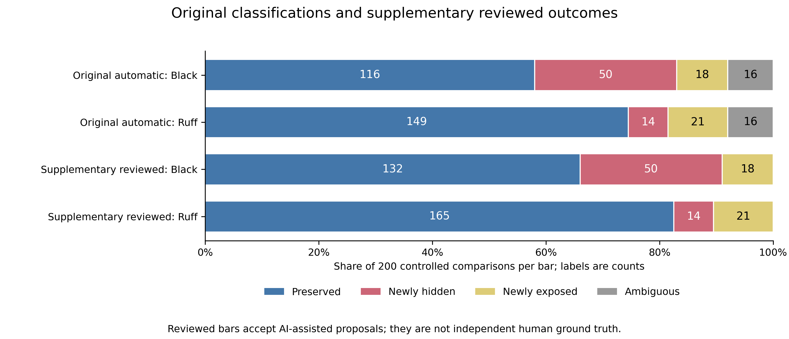

# Code Formatting and Linter Suppressions

A `noqa` comment can change its effect even when its text stays the same.
If a formatter joins two lines, a comment beside one name may end up suppressing
warnings for both. Splitting a line can expose a warning that the comment used
to cover.

This project tests those changes with Black and Ruff, using Ruff as the linter
in both cases. It follows individual warnings through formatting, after checking
that the parsed program structure has stayed the same. The question is about
warning visibility, not whether the linter's warning or the author's decision to
suppress it was correct.

## What was tested

The controlled suite crosses 25 templates with 8 directive modes:
200 inputs and 400 formatter comparisons. A separate sample has
40 files from pinned commits of Requests, Flask and pytest. The tools were
Black 25.1.0, Ruff 0.11.13 and CPython 3.11.9 on Windows, with F401, F821 and F841
as the selected rules. Analyzed programs were never executed; lint fixes were off.

For every source pair, Ruff runs with `noqa` respected and ignored, before and
after formatting. Ignoring the comments reveals the warnings that ordinary lint
output hides. Within each snapshot, the two outputs show what is suppressed.
Across snapshots, the matcher checks the rule, AST occurrence and node/token
context. A moved line number is not enough to identify the same warning.

## Findings

Black had 68 confirmed suppression changes among 200 controlled comparisons
(34.0%); Ruff had 35 (17.5%). Both hid and exposed warnings. These are counts
for deliberately constructed inputs, not estimates of frequency in Python projects.

The automatic matcher left 16 comparisons per formatter Ambiguous. A separate
AI-assisted review proposed Preserved for all 32, producing reviewed Preserved
counts of 132 and 165. Those proposals have not been independently
human-validated, and the automatic labels remain unchanged.



Each bar has 200 comparisons. The review changes the unresolved counts;
it adds no confirmed suppression changes.

No confirmed drift appeared in the 80 natural-source comparisons. There was
less opportunity to observe it: 65 outputs were unchanged, and 22 of the
40 original files had no underlying warnings from the selected rules.
Another 4 comparisons failed the strict AST check. The result leaves
behavior on other files and rules open.

## Reproduce the work

Use a committed Git checkout with Git on PATH. From the root in PowerShell:

```powershell
py -3.11 -m venv .venv
.\.venv\Scripts\python.exe -m pip install -r requirements-analysis-lock.txt
.\.venv\Scripts\python.exe -m pip install --no-deps --no-build-isolation -e .
.\.venv\Scripts\python.exe -m pytest -q
```

The [reproduction guide](docs/reproducibility.md) covers saved-result checks,
fresh runs and analysis outputs. A fresh pinned environment on the same Windows
host reproduced every primary comparison. Other machines and platforms remain
untested. Templates reuse code across treatments, AST equality is not runtime
proof, and the statistical intervals are exploratory. Independent detector
accuracy is still unmeasured.

## Read the results and evidence

The [public report](report/research_report_public.md) and
[PDF](report/research_report_public.pdf) explain the design and interpretation.
The [evidence guide](docs/evidence_guide.md) connects examples to source pairs,
diagnostics, [automatic metrics](reports/phase5/analysis/metrics.json),
[reviewed metrics](reports/publication-phase-a/analysis/metrics.json) and the
[ambiguity audit](reports/ambiguous-audit/ambiguous_comparisons_review.md).

AI assisted implementation, debugging, template construction, analysis and writing;
see the [disclosure](docs/ai_use.md). The [public snapshot notes](docs/public_snapshot.md)
explain anonymized metadata, lossless source containers and omitted archives.
[MIT](LICENSE) covers author-owned code and documentation. Upstream material keeps
the terms in [third-party notices](THIRD_PARTY_NOTICES.md).
