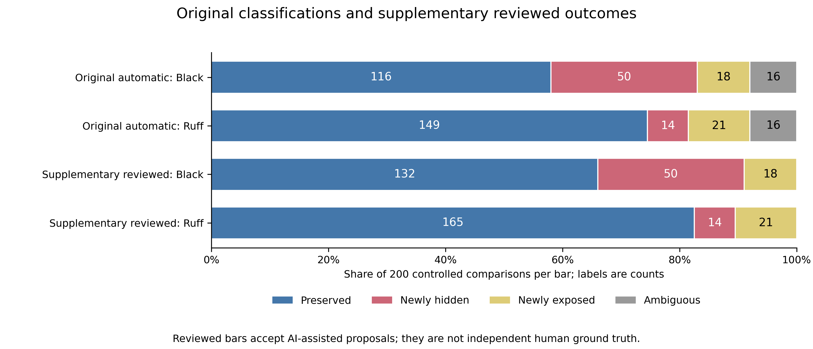

# Code Formatting and Linter Suppressions

Abdul Nafeh

Independent research report | November 2026

## 1. Introduction

A `noqa` comment affects linting through its position in the source. Joining two lines can put more code under the same comment; splitting a statement can leave part of it uncovered. Neither change requires a different parsed program structure. This study asks when Black and Ruff produce such changes for three selected Ruff rules.

For example, `# noqa: F821` suppresses undefined-name warnings within its scope. If formatting moves that comment beside two names instead of one, a warning may disappear from ordinary lint output while the name that caused it is still present. The reverse can happen when a formatter separates statements.

The comparison follows warning occurrences, rather than just counting them. Equal counts can conceal a swap in visibility, and changed counts can reflect different underlying diagnostics. Each source pair therefore goes through four lint passes and a correspondence check before a change is attributed to suppression.

Controlled inputs exercise particular layouts and directive placements. A separate sample of repository files checks for changes in naturally occurring source. The two datasets answer different questions and are reported separately.

## 2. Related Work

Hu et al. [1] studied suppressions across project histories. Their treatment of line splitting is relevant here because a changed warning count need not mean a new warning. Li and Yang [2] studied correspondence across revisions, a broader setting than the AST-stable, rule-restricted pairs used in this experiment. McKeeman's differential-testing account [3] supplies the comparison principle: disagreement identifies a case to investigate.

Formatter documentation already describes this interaction. Black's FAQ discusses moved linter comments [4], and Ruff gives a list-collapse example that broadens `noqa` coverage [5]. This experiment measures that known possibility under fixed settings, with saved warning identities and a separate repository sample. It makes no claim to discovering the interaction.

## 3. Methodology

### 3.1 Four diagnostic checks

The runs used CPython 3.11.9, Black 25.1.0 and Ruff 0.11.13 on Windows. Formatting targeted Python 3.11 with line length 88 and preview disabled. Ruff selected F401 (unused import), F821 (undefined name) and F841 (unused local variable), with fixes disabled [6]. These are historical pins, not current-release recommendations. Analyzed programs were never executed.

| Pass | Source | Suppression comments |
|---|---|---|
| A | Original | Respected |
| B | Original | Ignored |
| C | Formatted | Respected |
| D | Formatted | Ignored |

Passes B and D reveal warnings hidden by `noqa`. Within one snapshot, the difference between underlying and visible diagnostics identifies suppression. The visible output must be a multiset subset of the underlying output. Rule, message and exact range identify a warning for this within-source subtraction; those coordinates cannot identify it across formatting.

### 3.2 Syntax and warning correspondence

The first attribution gate compares abstract syntax trees (ASTs), which represent parsed program structure. Parsing includes type comments, while the comparison omits ordinary location attributes such as a node's source line. Unequal trees stop suppression attribution. This is not a proof of runtime equivalence. In particular, `TypeIgnore.lineno`, the line recorded for a type-ignore directive, is an AST field rather than an ordinary location attribute, so it can still cause an exclusion.

Across snapshots, the matcher identifies a warning by its rule and AST field/index path: its position within the parsed structure, rather than its physical line. It then checks that the node content and the tokens forming the construct and diagnostic span agree. Supported anchors are import aliases, names read in expressions, and names assigned to local variables. An anchor is the source construct to which the warning is attached; unsupported or non-unique anchors leave correspondence unresolved.

Only complete correspondence with unchanged underlying warnings permits a visibility judgment. Visible to suppressed is Newly hidden; suppressed to visible is Newly exposed; both directions together give Mixed. Preserved means no visibility transition under these checks. Ambiguous, Diagnostic changed, AST changed and Execution failure record different reasons for withholding that judgment.

### 3.3 Inputs

The controlled design crosses 25 distinct syntax templates with eight directive variants, yielding 200 inputs. The variants are no directive, a standalone specific directive, specific and blanket directives at each of two inline sites, a multicode directive at the first site, and a file-level specific directive. Each template reuses the same executable structure across variants. AI assisted construction of the saved synthetic templates. Deterministic Python generated and validated the inputs, and a fixed seed (20261103) ordered their execution. The design was frozen before the main run.

The natural sample has 40 files from pinned Requests, Flask and pytest commits. Eligibility required UTF-8 Python under the study grammar, a genuine `noqa` comment, the documented size cap and generated/vendored exclusions. Seeded hash ranking selected files without using their results. Primary linting used standardized settings and an artificial filename. Separate checks used archived Ruff configuration and original paths where available; they did not reproduce full project CI.

### 3.4 Analysis and supplementary review

Both formatters received each original input, so their outcomes are paired. Treatments from one template also share structure. Whole-cluster resampling draws groups of related observations together, retaining their directive treatments and formatter pairing [7]. Family-incidence Wilson calculations instead summarize whether a template family contains any drift [8]. The former describes a paired difference; the latter describes family incidence. Detailed interval choices followed the earlier outcome counts, making the analysis exploratory.

A later review revisited every Ambiguous comparison using literal source occurrences, saved diagnostics and comment-only interventions. These interventions neutralize the suppression comment while retaining executable structure, so that its effect on visibility can be checked. The review proposed Preserved for all 32 comparisons. Separate reviewed calculations apply those proposals conditionally; the automatic labels, original analysis and matcher are unchanged.

AI tools assisted implementation, debugging, controlled input generation, analysis scripts and writing, including this editorial revision. Measurements came from executed tools, with deterministic input and consistency checks. The supplementary review was also AI-assisted, not independent human adjudication. Natural source was collected without study-generated edits; its authors' AI use is unknown.

<!-- pagebreak -->

## 4. Results

### 4.1 Controlled comparisons

Black had 68 confirmed suppression changes and Ruff 35 on the same 200 inputs: 400 comparisons in total. These account for 34.0% and 17.5% of scheduled comparisons, respectively. The denominators include the unresolved cases listed below. No controlled comparison had an execution failure, AST change, underlying-diagnostic change or mixed drift.

| Outcome | Original Black | Original Ruff | Reviewed Black | Reviewed Ruff |
|---|---:|---:|---:|---:|
| Preserved | 116 | 149 | 132 | 165 |
| Newly hidden | 50 | 14 | 50 | 14 |
| Newly exposed | 18 | 21 | 18 | 21 |
| Ambiguous | 16 | 16 | 0 | 0 |

Each column contains 200 comparisons. The automatic columns keep the original labels. The reviewed columns apply only the supplementary proposals; confirmed-change counts stay the same. Figure 1 shows both versions.



The automatic comparison resolves 184 input pairs. On that common subset, drift is 36.96% for Black and 19.02% for Ruff, a difference of 17.93 percentage points. Accepting the review expands the denominator to 200 pairs and gives 16.50 points. The difference changes because the added pairs are reviewed as no drift for both formatters, not because more changes were found.

| Paired drift status | Ruff no drift | Ruff drift |
|---|---:|---:|
| Black no drift | 132 | 0 |
| Black drift | 33 | 35 |

The table uses the supplementary 200 pairs. A shared drift entry means both formatters changed visibility; it does not require the same direction of change.

### 4.2 Ambiguity and uncertainty

Two template families account for the ambiguity. In 16 f-string comparisons, original and formatted bytes are identical, but Python 3.11 tokenization does not expose the embedded identifier as a complete token span the matcher can use. In 16 exception-binding comparisons, only assignment spacing changes. Python stores the bound exception name as text in `ExceptHandler.name`, rather than as the assignment-name node supported by the matcher. Both cases concern missing correspondence support, not an automatically established absence of suppression changes.

The separate review found no visibility transition in these cases, checking 128 saved lint replays and 64 comment interventions. Human-interpretation flags remain, particularly for identifying the same exception binding. Accepting the proposed labels resolves these saved cases for a supplementary calculation; it does not validate a general extension of the matcher.

| Cluster model | Original difference interval (pp) | Reviewed difference interval (pp) |
|---|---|---|
| Template families | 8.70 to 28.26 | 8.00 to 25.50 |
| Syntax categories | 5.92 to 32.14 | 4.89 to 30.29 |

Intervals are in percentage points (pp). Each exploratory 95% model interval uses 20000 paired whole-cluster draws. The original analysis has 23 complete families and 12 categories; the reviewed analysis has 25 and 13. Its intervals were recalculated with the new denominator. Figure 2 shows the reviewed profiles, paired table and intervals. Original unresolved-outcome bounds and family-level Wilson results remain separate. None of these intervals establishes ecosystem coverage.

### 4.3 Source patterns

The following source pair is copied from the verified controlled trial `list_short--specific_first` with Black 25.1.0.

Before formatting:

```python
value = [missing_a,  # noqa: F821
    missing_b]
```

After formatting:

```python
value = [missing_a, missing_b]  # noqa: F821
```

Before formatting, Ruff reports `missing_b` while the directive suppresses `missing_a`. After formatting, the same directive covers both names. Ignoring `noqa` reports both names in either source, and the strict AST gate passes. The `missing_b` warning is therefore Newly hidden, as recorded in the trial's [result](https://github.com/AbdulNafeh10/formatter-suppression-study/blob/8c8ed2eec2053293a339275502916a8276f8210f/datasets/results/phase3/trials/list_short--specific_first/black/result.json). Ruff formatting kept this list expanded. With semicolon-separated assignments, both formatters instead split a line and exposed a warning previously covered by its trailing comment.

The pattern tables describe the fixed input/treatment grid, whose cells reuse templates. Figure 3 groups drift by category and placement. Its boundary cells use the review; the original figure keeps those cells unresolved.

Text changed in 133 Black comparisons and 118 Ruff comparisons. Of these, 57 and 75 were automatically Preserved; the reviewed counts are 65 and 83. Reformatting text and changing suppression are different events.

<!-- landscape -->


<!-- pagebreak -->


<!-- portrait -->

### 4.4 Natural-source comparisons

The 80 primary comparisons of 40 repository files produced no confirmed suppression change. The supplementary ambiguity review does not alter these results.

| Repository | Files tested | Black Preserved / AST excluded | Ruff Preserved / AST excluded |
|---|---:|---|---|
| Requests | 7 | 7 / 0 | 7 / 0 |
| Flask | 13 | 12 / 1 | 13 / 0 |
| pytest | 20 | 18 / 2 | 19 / 1 |

Only 15 outputs changed; 65 stayed identical. Of the original files, 22 had no underlying selected-rule warnings, corresponding to 44 comparisons. A natural `noqa` comment can target rules outside this study, so eligibility alone did not guarantee relevant warnings. Figure 4 shows that diagnostic relevance, counting original files once.


The 4 AST exclusions came solely from shifted `TypeIgnore.lineno` fields. Zeroing those fields in a secondary investigation made the dumps equal, but the primary labels stay excluded. Native-configuration checks completed 66 comparisons with the same outcome classifications as the primary checks. Another 14 Requests records report missing configuration; they are statuses, not executed native comparisons.

The first natural repeat sample happened to contain only unchanged outputs. Phase 7 later repeated all 80 primary comparisons, including all 15 changed outputs, and matched the originals. This extends repeatability coverage while leaving the independent sample unchanged.

<!-- pagebreak -->

## 5. Discussion

Ruff had fewer suppression changes overall in this controlled suite, but fewer total changes did not mean fewer exposed warnings. Hiding and exposure need to be read separately. The comparison is about these inputs, settings and tool versions, not a general ranking of the formatters.

In the list and semicolon pairs, the underlying warning still belongs to the same source occurrence. What changes is whether the directive covers it. That distinction is the reason for checking correspondence before visibility. The experiment does not judge whether the warning is useful or whether a formatter should adopt a particular comment policy.

The natural sample offers fewer opportunities to observe those mechanisms: most outputs were unchanged and many selected warning sets were empty. Prior formatting could be one explanation for unchanged text, but repository formatting history was not measured here. A follow-up could define a separate stratum with relevant warnings and changed formatter output; its rate would describe that stratum, not all Python files.

The review also separates two matcher limitations from actual visibility changes. A wider matcher would need new anchors for those constructs, followed by testing on independently checked held-out examples. Resolving these saved cases alone cannot establish how that extension would behave elsewhere.

## 6. Limitations

The templates deliberately stress selected layouts, and directive variants share code. Cluster resampling keeps related treatments together. It still assumes that the groups being resampled are independent and exchangeable, meaning they can stand in for other groups under the model. Authored templates do not establish that assumption. Interval choices followed the earlier counts. Reviewed intervals also assume the proposed labels are correct and do not account for errors in the AI-assisted review.

The repository sample is limited to a few historical projects chosen for feasibility. UTF-8, Python-grammar, file-size, generated/vendored and natural-comment filters restrict which files could enter the sample. Empty selected-warning sets and unchanged outputs further limit what the zero result can tell us. The original analysis reports each archive's eligible population and completion bounds, which bound possible outcomes among unresolved or unobserved cases rather than estimate a Python-wide rate.

The AST gate and supported warning anchors limit attribution. AST equality does not prove runtime equivalence, and unsupported correspondence remains uncertain. The same AI-assisted process developed implementation, examples, tests and interpretation. Controls and repeated runs can expose inconsistencies, but they do not supply labels independently checked by reviewers on held-out inputs. Precision, recall and F1, which would measure matching errors against such labels, remain unmeasured.

Testing covered the pinned Windows/Python environment. The artificial primary filename differs from real project context, and native checks restore only part of that context. Other machines, operating systems, releases, diagnostic families and full project CI were not evaluated.

## 7. Conclusion

On the controlled inputs, formatting changed which Ruff warnings were suppressed while passing the strict AST gate. The repository sample produced no confirmed change. The later review supports Preserved proposals for the original ambiguities and leaves their automatic labels intact.

The next evaluation should establish correspondence accuracy on independently reviewed held-out pairs. A larger natural sample with relevant warnings and changed output would address a different gap. Both are needed before presenting this implementation as a developer check with measured error rates.

<!-- pagebreak -->

## 8. References

[1] Huimin Hu, Yingying Wang, Julia Rubin, and Michael Pradel. 2025. An Empirical Study of Suppressed Static Analysis Warnings. Proceedings of the ACM on Software Engineering 2(FSE), Article FSE014. [DOI](https://doi.org/10.1145/3715729). [Published author text](https://software-lab.org/publications/fse2025_suppressions.pdf).

[2] Junjie Li and Jinqiu Yang. 2024. Tracking the Evolution of Static Code Warnings: The State-of-the-Art and a Better Approach. IEEE Transactions on Software Engineering 50(3), 534-550. [DOI](https://doi.org/10.1109/TSE.2024.3358283). [Author text](https://jinqiuyang.github.io/papers/staticdiff-tse24.pdf).

[3] William M. McKeeman. 1998. Differential Testing for Software. Digital Technical Journal 10(1), 100-107. [Original journal](https://vmssoftware.com/docs/dtj-v10-01-1998.pdf).

[4] Black contributors. Frequently Asked Questions, version 25.1.0. [Versioned source](https://github.com/psf/black/blob/25.1.0/docs/faq.md).

[5] Astral contributors. Known Deviations from Black, Ruff 0.11.13. [Versioned source](https://github.com/astral-sh/ruff/blob/0.11.13/docs/formatter/black.md).

[6] Astral contributors. Ruff [linter](https://docs.astral.sh/ruff/linter/) and [formatter](https://docs.astral.sh/ruff/formatter/) documentation. Current pages provide background; retained pinned help and actual commands govern the experiment.

[7] StataCorp. Bootstrap resampling reference manual, cluster resampling. [Manual](https://www.stata.com/manuals/rbootstrap.pdf). The calculation here used NumPy, not Stata.

[8] NIST/SEMATECH. e-Handbook of Statistical Methods, confidence limits for a proportion. [Wilson method](https://www.itl.nist.gov/div898/handbook/prc/section2/prc241.htm).

### Data and reproduction

The repository contains the experiment code, this report and a checksum-verified evidence bundle. The bundle holds the original inputs, four-pass diagnostics, source snapshots, automatic classifications and separate ambiguity review. The reproduction command checks fresh comparisons against the saved trials and recomputes the original and reviewed metrics and plots. The archived analysis specification records the assumptions behind the interval calculations. [Repository and instructions](https://github.com/AbdulNafeh10/formatter-suppression-study).

Natural source is stored with upstream notices and original source checksums. Public execution records use placeholders for private machine paths. The retained sample supports offline reruns after dependency installation. Reconstructing sample selection also requires the pinned upstream archives. Earlier repeat exports and protocols are available in the [prior public snapshot](https://github.com/AbdulNafeh10/formatter-suppression-study/tree/8c8ed2eec2053293a339275502916a8276f8210f). [MIT](../LICENSE) covers the study code and documentation. Upstream terms are listed in the [third-party notices](../study/THIRD_PARTY_NOTICES.md).
